# Hi there, I'm Abhishek Jain 👋

### A Passionate Backend Developer from India 🇮🇳

  

---

## 🚀 About Me

- 🌱 I'm currently learning **Java** and diving deeper into **Backend Development**
- 💻 I love building scalable and efficient backend systems
- 🎯 Goal: To become a skilled **Backend Engineer** and contribute to impactful projects
- 📫 How to reach me: **abhishekjain24342@gmail.com**
- ⚡ Fun fact: I enjoy solving problems and writing clean, maintainable code

---
## 🛠️ Technical Skills

  <table>
    <tr>
      <td align="center" width="100">
        
         <b>Java</b>
      </td>
      <td align="center" width="100">
        
         <b>Python</b>
      </td>
      <td align="center" width="100">
        
         <b>JavaScript</b>
      </td>
      <td align="center" width="100">
        
         <b>HTML</b>
      </td>
      <td align="center" width="100">
        
         <b>CSS</b>
      </td>
    </tr>
    <tr>
      <td align="center" width="100">
        
         <b>MySQL</b>
      </td>
      <td align="center" width="100">
        
         <b>NumPy</b>
      </td>
      <td align="center" width="100">
        
         <b>Pandas</b>
      </td>
      <td align="center" width="100">
        
         <b>Matplotlib</b>
      </td>
      <td align="center" width="100">
        
         <b>Seaborn</b>
      </td>
    </tr>
  </table>

---

## 🌐 Connect with Me

  
  

---

## 🏅 Holopin Badges

---

## 🎮 Pac-Man Contribution Graph

<picture>
  <source media="(prefers-color-scheme: dark)" srcset="https://raw.githubusercontent.com/abhishek-Jain24/abhishek-Jain24/output/pacman-contribution-graph-dark.svg">
  <source media="(prefers-color-scheme: light)" srcset="https://raw.githubusercontent.com/abhishek-Jain24/abhishek-Jain24/output/pacman-contribution-graph.svg">
  
</picture>

---

## 📊 GitHub Stats

  

  
  

  

---
## 🏆 GitHub Trophies

  

---

⭐️ From [Abhishek Jain](https://github.com/abhishek-Jain24)
